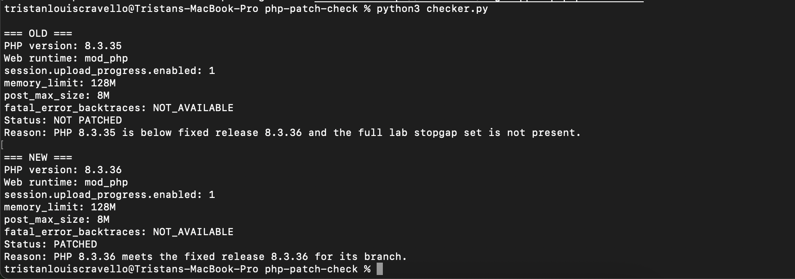
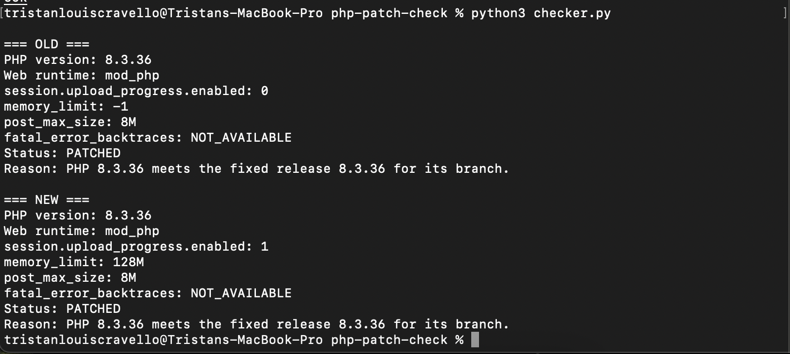

# PHP Patch Check

PHP Patch Check is a defensive local lab for verifying the fixes released for CVE-2026-109618 and CVE-2026-109619. It uses version and configuration inspection only. It does not contain exploit code, attack payloads, malformed requests, or deliberate memory exhaustion.

## What the two bugs mean

CVE-2026-109618 is an out-of-memory handling flaw. In plain English, PHP could jump out of request work while internal data was only partly initialized. Cleanup could later trust that incomplete data as if initialization had finished.

CVE-2026-109619 is a stale-state flaw across requests. Request-owned state could remain after its backing memory had been freed. A later request handled by the same worker could use that stale state before normal initialization reset it.

Both issues could allow unauthenticated remote code execution. Updating is the only complete mitigation.

## What the checker does

For the `old` and `new` Compose services, the checker reports:

- PHP version
- Web runtime
- `session.upload_progress.enabled`
- `memory_limit`
- `post_max_size`
- `fatal_error_backtraces`, when available
- `PATCHED`, `NOT PATCHED`, or `NOT PATCHED, PARTIAL MITIGATIONS PRESENT`
- One plain-English reason

The fixed releases used by the checker are PHP 8.5.12, 8.4.27, 8.3.36, and 8.2.35. PHP 8.1 and older are reported as unsupported by the PHP project.


## Safety boundaries

- Both Apache ports bind explicitly to `127.0.0.1`.
- The checker inspects running containers through Docker.
- No diagnostic PHP page is exposed.
- No vulnerability is triggered or reproduced.
- Do not change the port mappings to all interfaces.

## Run the final patched state

```bash
docker compose up --detach
python3 checker.py
```

Open the harmless pages at:

- http://127.0.0.1:8081
- http://127.0.0.1:8082

## Reproduce the before-and-after check

1. Change the `old` image in `compose.yaml` to `php:8.3.35-apache`.
2. Run `docker compose up --detach old`.
3. Run `python3 checker.py` and capture the NOT PATCHED result.
4. Apply the stopgap settings in `config/old.ini`, restart `old`, and observe the partial-mitigation result.
5. Restore `php:8.3.36-apache`, run `docker compose up --detach old`, and confirm PATCHED.


## Why the stopgaps are not a fix

For this no-upload Hello World lab, the temporary settings are:

```ini
session.upload_progress.enabled=0
memory_limit=-1
post_max_size=8M
```

They reduce specific confirmed paths. They do not cover underlying allocation failure or every way request-owned state could survive. PHP states that they do not make an installation safe.

## Evidence

### Before



### After



## What I learned

- A page can look healthy while its runtime is missing a critical security fix.
- Patch checks must compare releases within the correct PHP branch.
- Configuration mitigations can reduce exposure without removing vulnerable code.
- Remediation is stronger when the same checker proves the result before and after an update.


## Cleanup

Pause the lab:

```bash
docker compose stop
```

Remove its containers and network:

```bash
docker compose down
```

## Official sources

- [PHP security release, 21 October 2026](https://www.php.net/archive/2026.php#2026-10-21-5)
- [GHSA-w8hw-w9fx-j79w: RCE via OOM corruption](https://github.com/php/php-src/security/advisories/GHSA-w8hw-w9fx-j79w)
- [GHSA-6wmf-4rv5-p3rp: RCE via stale global state](https://github.com/php/php-src/security/advisories/GHSA-6wmf-4rv5-p3rp)